# 1.1.10 Preguntas frecuentes (FAQ)

Esta sección reúne las dudas más habituales de los usuarios de LUBIX y las responde de forma breve, con remisión al apartado del manual donde el procedimiento se explica en detalle. Está dirigida a los tres perfiles de la plataforma —Usuario Final, Empresa y Administrador— y complementa los apartados 1.1.5 (ingreso al sistema), 1.1.7 (funciones del sistema), 1.1.8 (mesa de ayuda) y 1.1.9 (mensajes de error).

> **Cómo usar esta sección:** si la duda se refiere a un error concreto que aparece en pantalla, se recomienda consultar primero el apartado 1.1.9. Si la duda no queda resuelta aquí, el canal de soporte y los tiempos de atención se describen en el apartado 1.1.8.

---

## 1.1.10.1 Acceso y cuenta

### 1. ¿Qué pestaña debo elegir en el inicio de sesión, Usuario o Empresa?

Depende del tipo de cuenta:

| Tipo de cuenta | Pestaña correcta | Pantalla de destino |
|---|---|---|
| Usuario Final / Cliente | **Usuario** | Inicio del usuario (`/home-usuario`) |
| Administrador | **Usuario** | Panel administrativo (`/dashboard-admin`) |
| Empresa | **Empresa** | Panel de empresa (`/dashboard-empresa`) |

La pestaña **Usuario** es compartida por el Usuario Final y el Administrador; el sistema distingue el rol en el servidor. Si seleccionas la pestaña equivocada, aunque las credenciales sean correctas el ingreso se rechaza con un mensaje que indica qué pestaña usar. Procedimiento completo en el apartado 1.1.5.4.

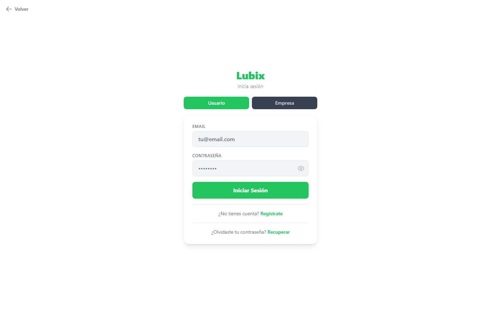

*Figura 1.1.10-1. Selector de perfil en la pantalla de inicio de sesión.*

### 2. Olvidé mi contraseña, ¿cómo la recupero?

1. En el inicio de sesión, selecciona **Recuperar** (o abre la ruta `/recover`).
2. Ingresa el correo registrado y pulsa **Enviar código**.
3. Revisa el correo con asunto **Recuperación de contraseña** y copia el código de seis dígitos.
4. En la pantalla **Nueva contraseña**, ingresa el correo, el código, la nueva contraseña y su confirmación.
5. Pulsa **Restablecer** e inicia sesión con la nueva contraseña.

El código es de un solo uso y tiene vigencia limitada; al solicitar uno nuevo, el anterior queda invalidado. El detalle está en el apartado 1.1.5.8.

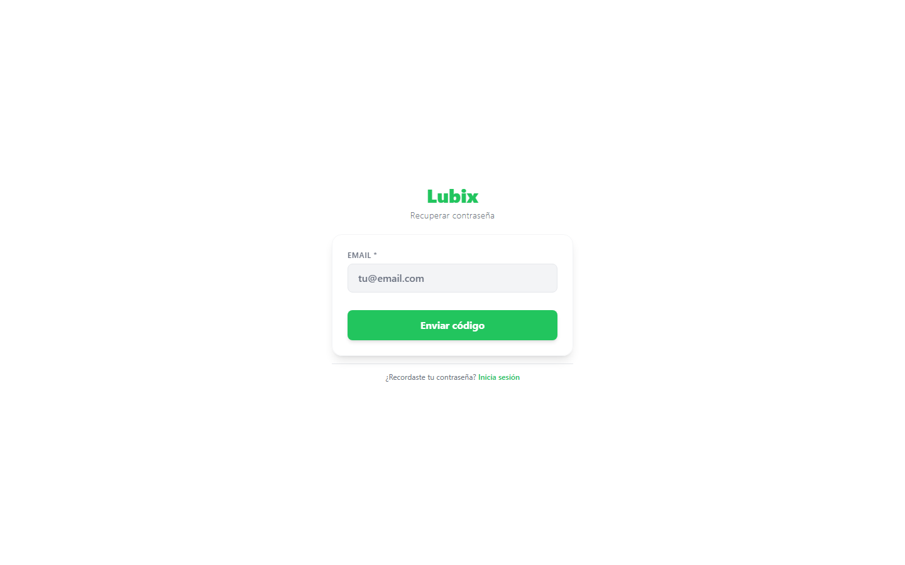

*Figura 1.1.10-2. Pantalla de recuperación de contraseña.*

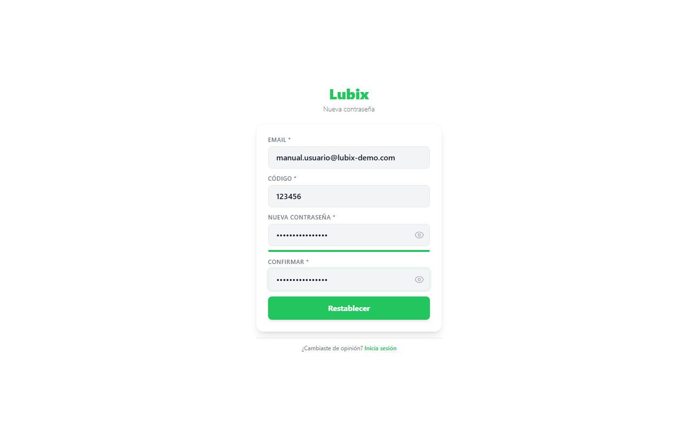

*Figura 1.1.10-3. Formulario de nueva contraseña con la barra de fuerza y los requisitos mínimos.*

### 3. No me llega el código de verificación o de recuperación. ¿Qué hago?

- Verifica la carpeta de correo no deseado o spam y confirma que el correo ingresado sea el registrado en LUBIX.
- Solicita un nuevo código desde la pantalla correspondiente. Si el código anterior no llegó, el nuevo lo reemplaza.
- Verifica la fecha y hora de tu dispositivo: una hora incorrecta puede afectar la vigencia del código.
- Si tras varios intentos el correo no llega, contacta a la mesa de ayuda por los canales del apartado 1.1.8 e indica el correo registrado, la fecha y la hora del intento.

### 4. ¿Qué requisitos debe cumplir mi contraseña?

Mínimo ocho caracteres, al menos una mayúscula, una minúscula y un número. No se aceptan contraseñas vacías ni compuestas solo por espacios. La barra de fuerza de la pantalla **Nueva contraseña** indica si cumples los cuatro requisitos. Se recomienda además usar una contraseña única, de más de doce caracteres y con caracteres especiales. Ver apartado 1.1.5.6.1.

### 5. El sistema me devolvió al inicio de sesión sin mostrarme un mensaje. ¿Por qué?

Cuando la sesión expira y no es posible renovarla, LUBIX elimina los tokens almacenados y redirige a `/login` sin mostrar un aviso específico: la redirección es la señal visible de que debes iniciar sesión de nuevo (apartado 1.1.9.2). Este comportamiento también ocurre si intentas abrir una ruta protegida sin sesión activa.

Para cerrar sesión correctamente, usa la opción **Salir** o **Cerrar Sesión** del menú; cerrar solo la pestaña o el navegador no elimina los tokens del dispositivo (apartado 1.1.5.6.4).

---

## 1.1.10.2 Catálogo, carrito y pedidos

### 6. ¿Cómo realizo una compra?

1. Desde el inicio del usuario, consulta el catálogo o usa el buscador y los filtros para ubicar el producto.
2. Abre el detalle del producto y agrégalo al carrito.
3. En el carrito, revisa cantidades y el total; luego continúa al checkout.
4. Completa los tres pasos del checkout: **envío**, **pago** y **revisión**. Confirma el pedido.

Los pasos ilustrados están en el apartado 1.1.7. El detalle del checkout muestra el resumen antes de confirmar.

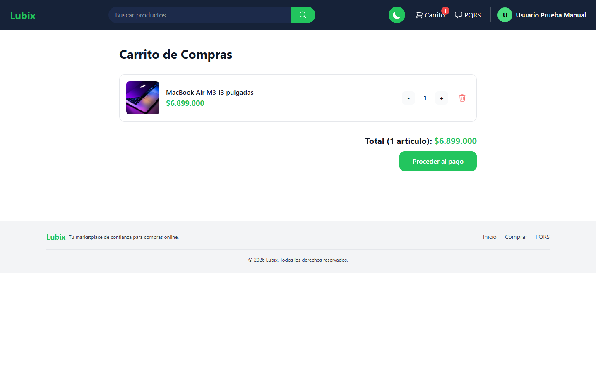

*Figura 1.1.10-4. Carrito de compras con los productos seleccionados y el resumen del pedido.*

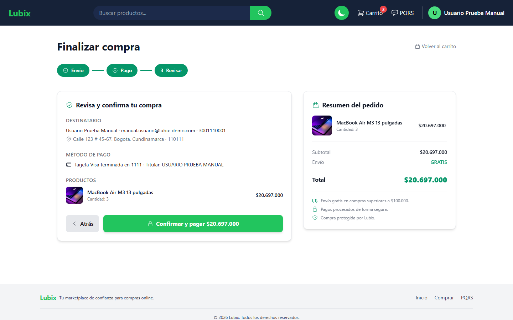

*Figura 1.1.10-5. Paso de revisión del checkout antes de confirmar el pedido.*

### 7. El catálogo se queda cargando y no muestra productos. ¿Qué hago?

Verifica primero la conexión y recarga la página. Si el problema persiste, repórtalo a la mesa de ayuda como incidente de prioridad P2 (apartado 1.1.8) e incluye: cuenta con la que ingresaste, perfil usado (Usuario o Empresa), navegador y versión, hora del intento y una captura de la pantalla. Esa información permite reproducir el caso y priorizarlo correctamente.

### 8. ¿Cómo consulto el estado de mi pedido?

Abre la opción **Mis pedidos** desde el menú del usuario. Allí se listan los pedidos con su fecha, valor y estado. Si el estado no cambia en un plazo razonable, radica una PQRS con el número o la referencia del pedido (apartado 1.1.8).

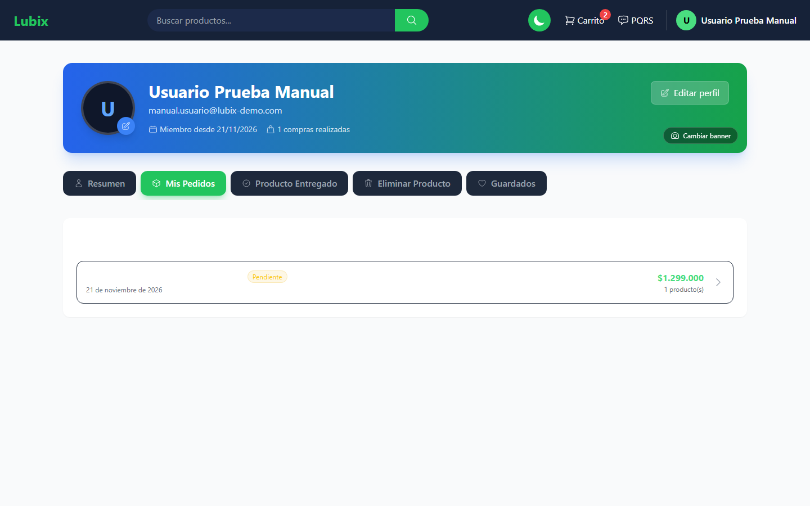

*Figura 1.1.10-6. Listado de pedidos del usuario con su estado.*

### 9. ¿Puedo cancelar un pedido?

Solo mientras el pedido esté en un estado que lo permita. Si la cancelación no es posible, la plataforma muestra el mensaje `No se pudo cancelar el pedido.` (apartado 1.1.9). En ese caso, radica una PQRS indicando el número de pedido para que el equipo comercial evalúe el caso.

---

## 1.1.10.3 Empresas

### 10. ¿Cómo publico un producto en el catálogo?

1. Inicia sesión por la pestaña **Empresa**.
2. En el panel de empresa, abre la sección de productos y pulsa **Nuevo producto**.
3. Completa nombre, descripción, categoría, precio, stock e imagen del producto. El precio debe ser un número mayor que cero y la imagen es obligatoria.
4. Guarda el producto y verifica que aparezca en el listado.

El procedimiento ilustrado está en el apartado 1.1.7 (funciones de Empresa).

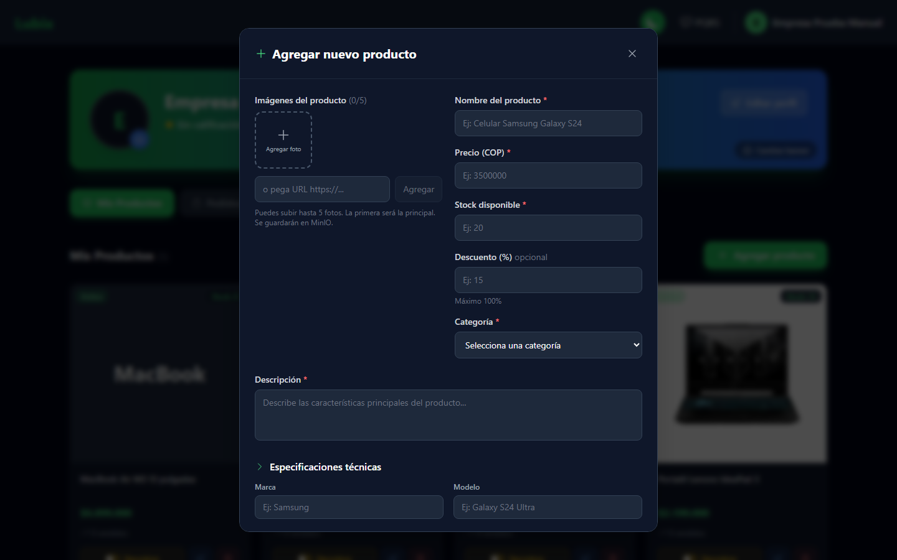

*Figura 1.1.10-7. Formulario de creación de producto en el panel de empresa.*

### 11. ¿Por qué no puedo ingresar con mi cuenta de empresa?

Revisa estas condiciones:

- La cuenta debe haberse creado mediante el registro empresarial.
- El correo debe estar verificado.
- Debe existir el registro de empresa asociado a la cuenta.
- La empresa debe haber sido validada por el equipo de LUBIX cuando el proceso lo requiera.

Si alguna condición falta, el sistema muestra `Cuenta de empresa no encontrada o no verificada por Lubix` y no entrega el token de acceso. En ese caso, contacta a la mesa de ayuda (apartado 1.1.8) o solicita la validación por el canal institucional.

### 12. ¿Dónde veo los pedidos que me hicieron y las estadísticas de mis productos?

En el panel de empresa, la sección **Pedidos** lista las órdenes recibidas y permite abrir el detalle de cada una. La sección **Estadísticas** muestra el rendimiento por producto. Ambas funciones se detallan en el apartado 1.1.7.

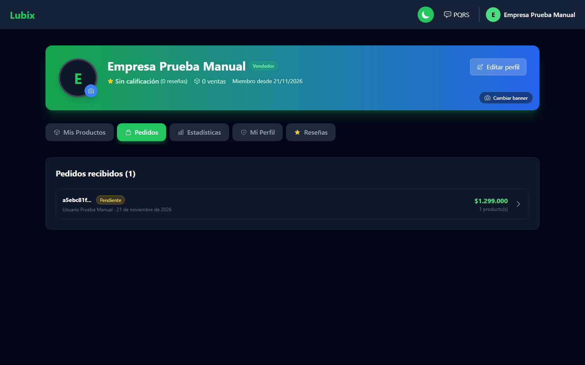

*Figura 1.1.10-8. Pedidos recibidos en el panel de empresa.*

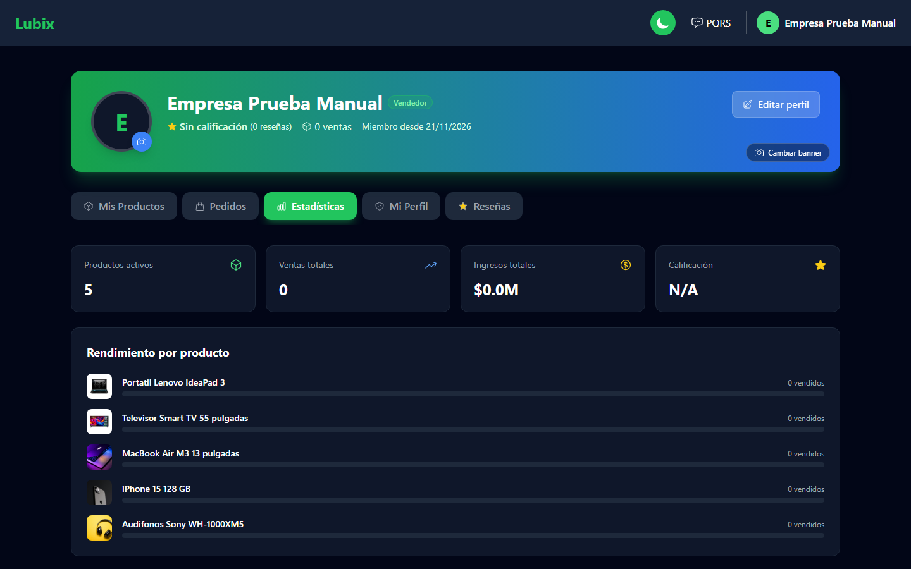

*Figura 1.1.10-9. Estadísticas de rendimiento por producto.*

---

## 1.1.10.4 PQRS y soporte

### 13. ¿Dónde radico una PQRS y cuánto tarda la respuesta?

Ingresa a la opción **PQRS** del menú principal y pulsa **Nueva solicitud**. Selecciona el tipo (petición, queja, reclamo o sugerencia), escribe el asunto y la descripción, y envía la solicitud. El seguimiento se consulta en **Mis solicitudes**, en la misma página.

Los tiempos de referencia de la mesa de ayuda son: P1 crítica, primera respuesta en 15 minutos y resolución en 4 horas; P2 alta, 1 hora y 8 horas; P3 media, 4 horas y 2 días hábiles; P4 baja, 8 horas y 5 días hábiles. La prioridad definitiva la asigna el equipo de soporte según impacto y urgencia (apartado 1.1.8).

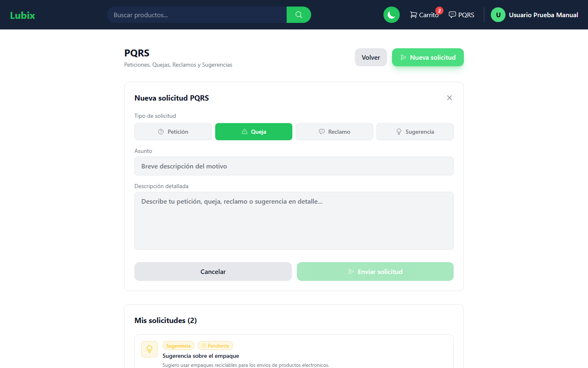

*Figura 1.1.10-10. Formulario de nueva solicitud PQRS.*

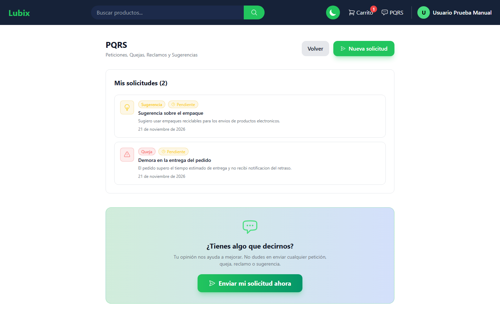

*Figura 1.1.10-11. Historial de solicitudes PQRS con su estado.*

### 14. ¿Dónde reporto un error técnico y qué información debo incluir?

Los errores técnicos se reportan por la mesa de ayuda (portal de tickets o correo institucional según el apartado 1.1.8); las PQRS se reservan para asuntos comerciales o relacionales. Incluye siempre:

- módulo o pantalla donde ocurrió, y la hora aproximada;
- pasos para reproducirlo, comportamiento esperado y observado;
- mensaje de error exacto y una captura de pantalla;
- navegador, sistema operativo y versión;
- impacto (a cuántos usuarios o procesos afecta).

Nunca incluyas contraseñas, códigos de verificación, tokens ni datos completos de tarjetas o documentos.

---

## 1.1.10.5 Seguridad

### 15. ¿LUBIX me pedirá la contraseña por correo, teléfono o mensajería? ¿Qué hago si sospecho un acceso no autorizado?

No. LUBIX **nunca** solicita contraseñas, frases de paso, códigos de verificación ni tokens por correo, teléfono o mensajería. Si recibes una solicitud de ese tipo, no respondas ni compartas información: repórtala de inmediato.

Ante un acceso no reconocido o una posible filtración de credenciales, cambia la contraseña desde la opción de recuperación y reporta el incidente en un plazo máximo de veinticuatro horas por el canal telefónico de guardia y mediante un ticket marcado con la categoría **Seguridad de la información**, según el apartado 1.1.8.

---

## 1.1.10.6 Criterios de aceptación de la sección

La sección de preguntas frecuentes se considera completa cuando:

1. Responde dudas de los tres perfiles: Usuario Final, Empresa y Administrador.
2. Es consistente con los apartados 1.1.5, 1.1.7, 1.1.8 y 1.1.9 del manual.
3. No inventa canales de soporte ni datos de contacto distintos a los del apartado 1.1.8.
4. No expone contraseñas, códigos vigentes, tokens ni datos personales.
5. Remite al apartado correspondiente cuando el procedimiento requiere mayor detalle.
