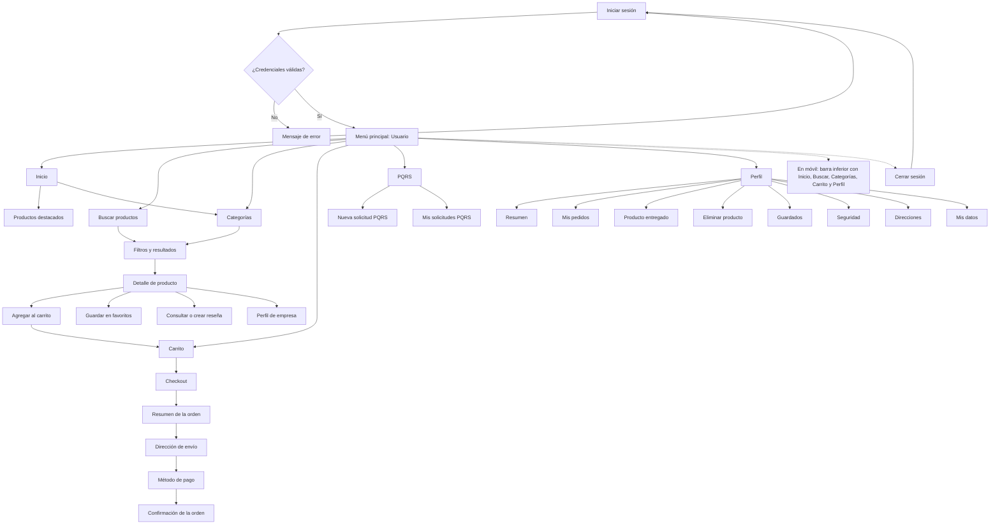
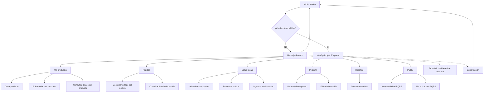
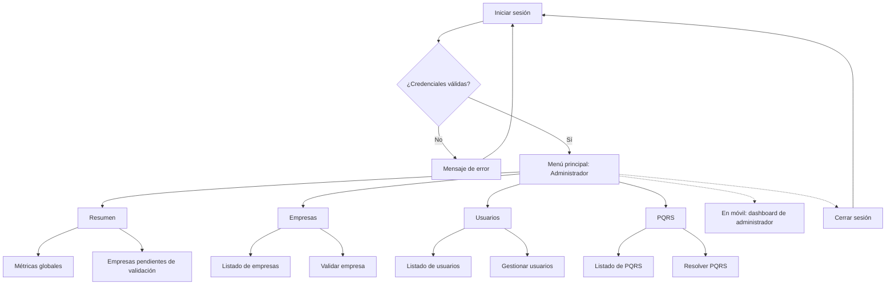

# 1.1.6 Mapa de navegación

## Introducción

La navegación de LUBIX se concibe como una experiencia orientada a tareas: cada pantalla debe permitir al usuario saber dónde se encuentra, qué puede hacer y cómo regresar al punto anterior sin perder el contexto. La plataforma organiza sus contenidos en una estructura jerárquica de tres niveles —menú principal, módulos y submódulos o acciones— que se adapta al rol de la cuenta: usuario final, empresa o administrador. Esta segmentación garantiza que cada perfil vea únicamente las funciones que le corresponden y reduce el riesgo de errores operativos.

El acceso a la plataforma se realiza mediante una aplicación web y una aplicación móvil que comparten la misma lógica funcional. En la web, la navegación principal se concentra en la barra superior, el menú del usuario y las pestañas internas de cada panel. En la aplicación móvil, la barra inferior de cinco pestañas —Inicio, Buscar, Categorías, Carrito y Perfil— cumple la función de menú principal, mientras que las acciones específicas se presentan en pantallas secundarias o en el flujo de checkout.

Los menús y submenús deben utilizarse como el mecanismo habitual de desplazamiento. Se recomienda evitar la navegación mediante la edición manual de direcciones URL, el uso repetido del botón “Atrás” del navegador o la apertura indiscriminada de pestañas duplicadas, ya que estas prácticas pueden generar estados inconsistentes, pérdida de datos en formularios o errores de sesión. Cuando una acción requiera confirmación, el sistema mostrará un mensaje o una pantalla de validación antes de ejecutarla.

### Filosofía de navegación

- **Consistencia:** los mismos módulos conservan nombres, iconos y ubicación en web y móvil, de modo que el usuario reconozca la función sin importar el dispositivo.
- **Jerarquía visible:** el menú principal conduce a los módulos; cada módulo presenta sus pestañas, filtros o acciones; las acciones críticas se confirman antes de ejecutarse.
- **Acceso por rol:** el sistema muestra únicamente las opciones autorizadas para el tipo de cuenta. Si un usuario intenta acceder a una ruta no permitida, se le redirige a su panel correspondiente.
- **Reconocimiento sobre memoria:** los iconos, etiquetas y agrupaciones permiten identificar las funciones sin necesidad de recordar rutas.
- **Prevención de errores:** las acciones destructivas —eliminar un producto, cancelar una operación, cerrar sesión— solicitan confirmación o presentan un estado claramente diferenciado.
- **Retroalimentación:** cada operación relevante produce un mensaje de éxito, advertencia o error, y mantiene al usuario en un contexto comprensible.

### Estructura general

1. **Capa pública:** página de inicio, catálogo, búsqueda, detalle de producto, perfil de empresa, inicio de sesión, registro y recuperación de contraseña.
2. **Capa de autenticación:** validación de credenciales, verificación de correo, recuperación y restablecimiento de contraseña.
3. **Capa de menú principal:** panel o menú correspondiente al rol autenticado.
4. **Capa de módulos:** funciones principales de cada rol, tales como catálogo, carrito, pedidos, productos, empresas, usuarios, PQRS o estadísticas.
5. **Capa de submódulos y acciones:** formularios, pestañas internas, filtros, modales, confirmaciones y pantallas de detalle.
6. **Capa transversal:** cambio de tema claro/oscuro, perfil, cierre de sesión y acceso a soporte mediante PQRS.

### Recomendaciones para el inicio de sesión

- Acceder siempre mediante la dirección oficial de LUBIX y verificar que la conexión utilice HTTPS en entornos productivos.
- Seleccionar correctamente el tipo de cuenta —Usuario o Empresa— antes de introducir las credenciales. Si el tipo seleccionado no coincide con la cuenta, el sistema mostrará un mensaje de error.
- Utilizar credenciales personales e intransferibles. No compartir contraseñas, códigos de verificación ni enlaces de recuperación.
- Evitar marcar la opción de recordar contraseña en equipos compartidos o de uso público.
- Si la cuenta no está verificada, completar el proceso de verificación por correo antes de intentar ingresar nuevamente.
- Si se olvidó la contraseña, utilizar la opción **Recuperar** y seguir el enlace o código enviado al correo registrado.
- Verificar que la fecha y la hora del dispositivo sean correctas, ya que una desincronización puede invalidar la sesión.
- Ante un mensaje de error persistente, registrar el texto exacto y contactar a la mesa de ayuda conforme al apartado 1.1.8.

### Recomendaciones para el cierre de sesión

- Cerrar la sesión desde el menú del usuario, eligiendo la opción **Cerrar Sesión**; no basta con cerrar la pestaña o el navegador.
- En la aplicación móvil, cerrar la sesión desde la pantalla de perfil antes de entregar, prestar o cambiar de usuario el dispositivo.
- En equipos compartidos, cerrar sesión y cerrar el navegador al finalizar la jornada.
- No utilizar el botón “Atrás” del navegador para intentar regresar a una pantalla protegida después del cierre de sesión; el sistema redirigirá al inicio de sesión.
- Si se sospecha que la sesión quedó abierta en otro dispositivo, cambiar la contraseña y reportar el hecho a la mesa de ayuda.
- Confirmar que la pantalla de inicio de sesión se muestre nuevamente antes de abandonar el equipo.

## Estándar de botones e iconos de la interfaz

La siguiente tabla establece el significado de referencia de los botones, iconos y símbolos más habituales. La representación gráfica puede variar ligeramente entre la aplicación web y la móvil, pero la función descrita se mantiene. Los iconos que no correspondan a una acción disponible en el rol del usuario no se mostrarán en la interfaz.

| Icono/Símbolo | Nombre del Botón | Función / Acción |
|---|---|---|
| 🏠 | Inicio | Regresa a la página principal del rol autenticado o al sitio público. |
| 🔍 | Buscar | Abre el buscador de productos y permite introducir palabras clave. |
| 🛒 | Carrito | Abre el carrito de compras; el indicador numérico muestra la cantidad de artículos. |
| 👤 | Perfil / Usuario | Despliega el menú del usuario con acceso al perfil y al cierre de sesión. |
| 💬 | PQRS | Abre el módulo de peticiones, quejas, reclamos y sugerencias. |
| 🌙 / ☀️ | Tema | Alterna entre el modo oscuro y el modo claro de la interfaz. |
| ☰ | Menú | Abre el menú de navegación lateral o la lista de opciones en dispositivos móviles. |
| ⌄ | Desplegable | Expande un submenú, una lista de opciones o un panel de filtros. |
| ← | Volver | Regresa a la pantalla o al paso anterior sin ejecutar la acción en curso. |
| ✖ | Cerrar | Cierra una ventana modal, un panel lateral o un formulario sin guardar cambios. |
| ✓ | Guardar / Confirmar | Guarda los cambios o confirma la acción solicitada. |
| ✚ | Agregar | Añade un producto al carrito, una dirección, una imagen o un registro nuevo. |
| − | Quitar / Disminuir | Reduce la cantidad de un producto o elimina un elemento de una lista temporal. |
| 🗑️ | Eliminar | Elimina un producto, una dirección, una solicitud o un registro; normalmente solicita confirmación. |
| 📦 | Pedidos | Abre el historial o la gestión de pedidos según el rol. |
| ❤️ | Guardados / Favoritos | Añade o retira un producto de la lista de favoritos. |
| ⭐ | Reseñas | Permite consultar, crear o gestionar calificaciones y reseñas de productos. |
| 📊 | Estadísticas | Muestra indicadores, métricas y reportes del panel de empresa o administración. |
| 🏢 | Empresas | Abre la gestión de empresas registradas y pendientes de validación. |
| 👥 | Usuarios | Abre la gestión de usuarios registrados. |
| 🛡️ | Seguridad | Accede a las opciones de seguridad de la cuenta y cambio de contraseña. |
| 📍 | Direcciones | Abre la gestión de direcciones de envío o de contacto. |
| 💳 | Pago | Inicia o configura el método de pago dentro del checkout. |
| 📄 | Factura / Documento | Descarga o consulta facturas, comprobantes y documentos adjuntos. |
| 🔁 | Reintentar | Vuelve a ejecutar una operación que falló por un error temporal. |
| ❓ | Ayuda | Abre la orientación, el centro de ayuda o el canal de soporte. |
| 🚪 | Cerrar Sesión | Finaliza la sesión activa y redirige a la pantalla de inicio de sesión. |

## Mapas de navegación por rol

Para facilitar la lectura y el mantenimiento del manual, la navegación se presenta en tres diagramas independientes: usuario, empresa y administrador. Cada uno parte del inicio de sesión, valida el tipo de cuenta y muestra el menú principal, los módulos y los submódulos correspondientes. La aplicación móvil reutiliza la misma estructura funcional; sus equivalencias se indican en la tabla posterior.

### Mapa de navegación del usuario

El usuario final accede a la plataforma, se autentica y llega a un menú principal desde el cual puede consultar el catálogo, buscar productos, gestionar el carrito, completar una compra, presentar PQRS y administrar su perfil. En la aplicación móvil, este mismo conjunto de funciones se organiza mediante la barra inferior de cinco pestañas.

### Mapa de navegación de la empresa

La cuenta de empresa accede a un panel orientado a la gestión comercial. Desde el menú principal puede administrar su catálogo, atender pedidos, consultar estadísticas, revisar reseñas, actualizar su perfil y presentar PQRS. En la aplicación móvil, estas funciones se concentran en el dashboard de empresa.

### Mapa de navegación del administrador

El administrador dispone de un panel de supervisión global. Su menú principal agrupa el resumen de métricas, la gestión de empresas, la gestión de usuarios y la administración de PQRS. Las acciones sensibles, como la validación de una empresa o la resolución de una solicitud, se ejecutan desde el módulo correspondiente y quedan sujetas a las políticas de seguridad y auditoría.

> **Cómo leer los diagramas:** los nodos rectangulares representan pantallas, módulos o acciones; los nodos con forma de rombo representan decisiones; las flechas indican el flujo permitido. Cada diagrama corresponde a un rol y parte del inicio de sesión. Las líneas discontinuas hacia **Cerrar sesión** significan que la acción está disponible desde el menú del usuario en cualquier módulo. La nota discontinua sobre el acceso móvil indica la forma en que se presenta el mismo conjunto de funciones en la aplicación. Los diagramas no representan rutas URL específicas, sino la jerarquía funcional de navegación.

## Correspondencia entre la navegación web y móvil

| Función | Acceso web | Acceso móvil |
|---|---|---|
| Inicio | Barra superior o logotipo LUBIX | Pestaña **Inicio** |
| Búsqueda de productos | Campo de búsqueda de la barra superior | Pestaña **Buscar** |
| Categorías | Página de inicio o resultados de búsqueda | Pestaña **Categorías** |
| Carrito | Enlace **Carrito** de la barra superior | Pestaña **Carrito** |
| Perfil | Menú del usuario > **Ver Perfil** | Pestaña **Perfil** |
| PQRS | Enlace **PQRS** de la barra superior | No disponible como pestaña; se accede desde la web |
| Cierre de sesión | Menú del usuario > **Cerrar Sesión** | Pantalla **Perfil** > **Cerrar sesión** |
| Panel de empresa | Menú **Mis productos**, **Pedidos**, **Estadísticas**, **Mi Perfil**, **Reseñas** | Pantalla de dashboard de empresa |
| Panel de administración | Pestañas **Resumen**, **Empresas**, **Usuarios**, **PQRS** | Pantalla de dashboard de administrador |

## Buenas prácticas de navegación

- Utilizar el menú principal y las pestañas internas para desplazarse; evitar cambiar manualmente la URL salvo que se conozca la ruta exacta.
- Antes de abandonar un formulario con datos sin guardar, verificar si el sistema muestra una advertencia; en caso contrario, guardar o cancelar explícitamente.
- No abrir varias pestañas para ejecutar la misma operación de compra o de gestión; puede generar duplicados o conflictos de sesión.
- Revisar el indicador del carrito después de agregar o eliminar productos.
- Confirmar el rol activo antes de realizar operaciones administrativas o de empresa.
- Si una pantalla no carga o muestra un error, utilizar la opción **Reintentar** o recargar una sola vez; si persiste, reportar el caso con el mensaje exacto y una captura.
- Al finalizar, cerrar sesión de forma explícita y verificar que la pantalla de inicio de sesión se muestre nuevamente.
