# 1.1.7 Descripción de las funciones del sistema

## Usuario Final (Cliente)

### Inicio y productos destacados

* **Propósito:** Presentar al usuario autenticado el catálogo vigente, las categorías y los productos destacados.
* **Pasos:**
  1. Acceder con **Inicio** en la barra superior o con el logo **Lubix** (`/home-usuario`).
  2. Recorrer los bloques **Categorías Principales** y **Productos Destacados**.
  3. Pulsar **Ver catálogo →** o una tarjeta de producto para abrir el detalle.
* **Figura 1.1.7-1.** Inicio del Usuario Final con productos destacados y acceso al catálogo.

  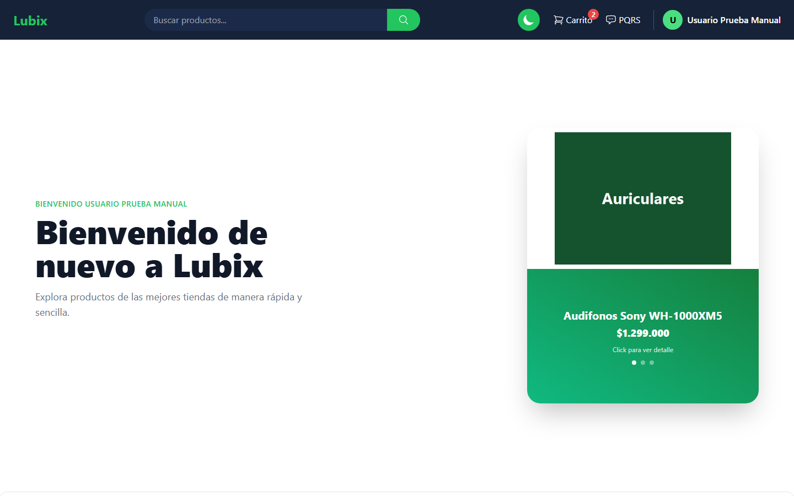

* **Figura 1.1.7-2.** Catálogo de productos con la búsqueda y las tarjetas de producto.

  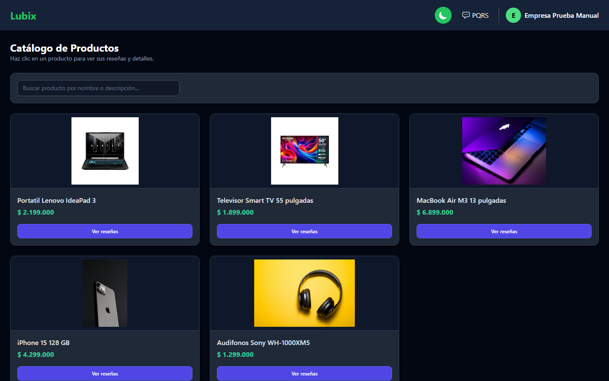

### Búsqueda y filtros

* **Propósito:** Localizar productos por palabra clave, categoría, rango de precio y criterio de orden.
* **Pasos:**
  1. Escribir el término en el campo **Buscar productos...** y confirmar con la lupa.
  2. Desplegar **Filtros** y seleccionar una **Categorías** o un **Rango de Precio** (Min/Max).
  3. Ajustar **Ordenar** entre Relevancia, Precio (menor/mayor) o Nombre (A-Z/Z-A).
  4. Pulsar una tarjeta de resultado; si no hay coincidencias, verificar el mensaje **Sin resultados**.
* **Figura 1.1.7-3.** Resultados de búsqueda con el panel Filtros y el selector Ordenar.

  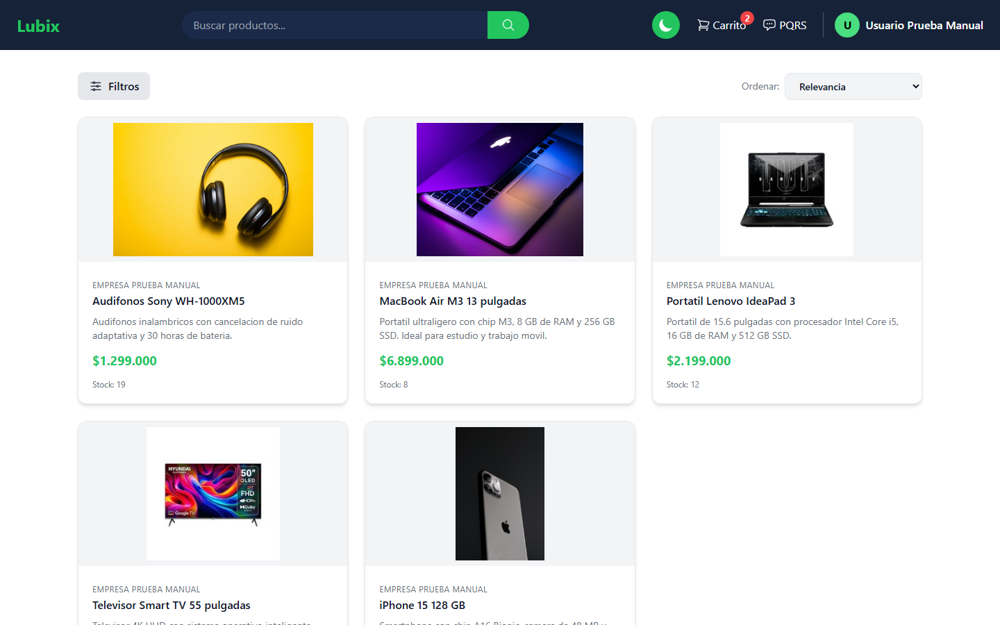

### Detalle de producto

* **Propósito:** Consultar la información completa del producto y habilitar las acciones de compra, guardado y reseña.
* **Pasos:**
  1. Revisar nombre, precio con IVA incluido, stock (**disponibles** o **Agotado**) y tienda vendedora.
  2. Ajustar la **Cantidad** con − / + dentro del stock disponible.
  3. Pulsar **Agregar al carrito**, **Guardar** o **Comprar** según la acción requerida.
  4. Consultar **Opiniones y Reseñas** con el promedio y la distribución por estrellas.
* **Figura 1.1.7-4.** Detalle del producto con precio, disponibilidad y los botones Agregar al carrito y Guardar.

  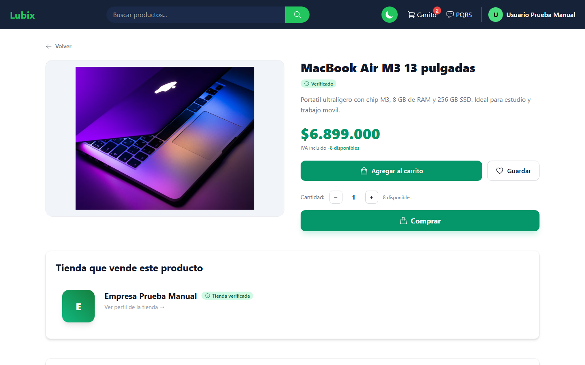

### Carrito de compras

* **Propósito:** Revisar y ajustar los productos seleccionados antes de iniciar el checkout.
* **Pasos:**
  1. Abrir **Carrito** en la barra superior; el indicador numérico muestra la cantidad de artículos.
  2. Revisar producto, precio unitario y cantidad de cada línea.
  3. Ajustar con − / + o eliminar con el ícono de papelera.
  4. Verificar **Total (N artículos)** y pulsar **Proceder al pago**.
* **Figura 1.1.7-5.** Carrito de compras con el total y el botón Proceder al pago.

  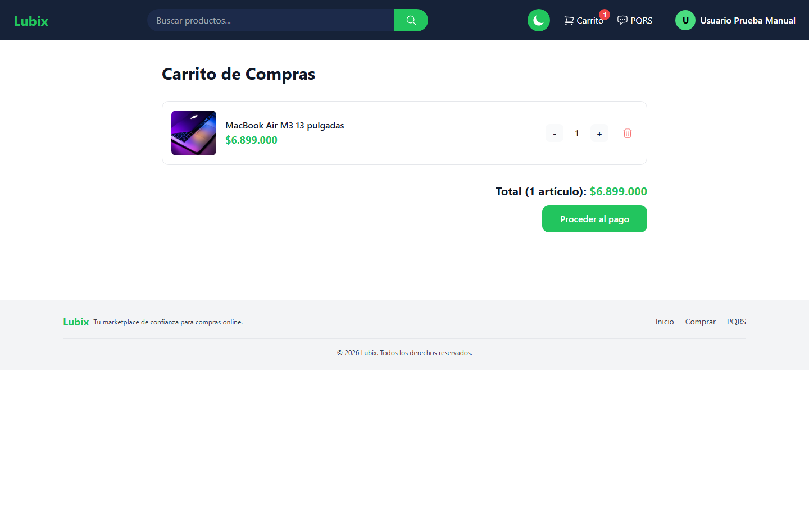

### Guardar en favoritos

* **Propósito:** Conservar productos de interés para consultarlos o retomarlos posteriormente.
* **Pasos:**
  1. Pulsar **Guardar** (corazón) en el detalle del producto o el corazón de la tarjeta en Inicio.
  2. Confirmar el cambio de estado a **Guardado** y la activación del ícono.
  3. Consultar o retirar los productos desde Perfil → **Guardados**.
* **Figura 1.1.7-6.** Botón Guardar del detalle de producto.

  

### Publicar reseña

* **Propósito:** Registrar una calificación y un comentario sobre un producto adquirido o consultado.
* **Pasos:**
  1. Iniciar sesión y ubicar el bloque **Escribe tu reseña** en el detalle del producto.
  2. Seleccionar la **Calificación** en estrellas.
  3. Diligenciar **Título (opcional)** y **Comentario** (obligatorio).
  4. Pulsar **Publicar reseña** y verificar el mensaje de confirmación.
* **Captura:** `[IMG: Producto_resena - Recuadro en estrellas de calificación y flecha a Publicar reseña]`

### Resumen de la orden

* **Propósito:** Validar los artículos y los valores de la compra antes de registrar el pedido.
* **Pasos:**
  1. En el carrito, verificar artículos y total.
  2. Pulsar **Proceder al pago** para abrir **Finalizar compra**.
  3. Revisar el panel **Resumen del pedido**: Subtotal, Descuento, Envío y Total.
  4. Confirmar la regla de envío: gratis desde $100.000; en caso contrario, $15.000.
* **Figura 1.1.7-7.** Resumen del pedido con Subtotal, Envío y Total.

  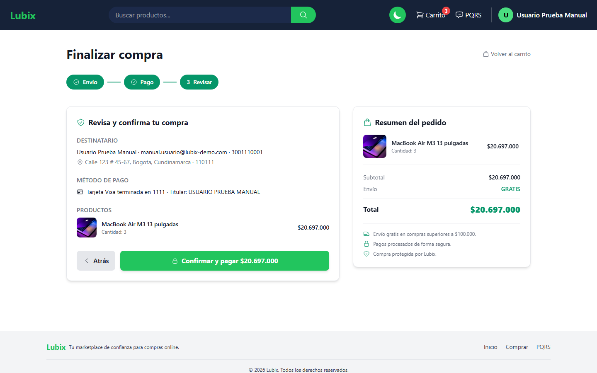

### Datos de envío

* **Propósito:** Registrar el destinatario y la dirección de entrega del pedido.
* **Pasos:**
  1. Completar **Nombre completo**, **Documento de identidad**, **Email** y **Teléfono**.
  2. Ingresar **Dirección de entrega**, **Ciudad**, **Departamento**, **Código postal** y **Notas de entrega**.
  3. Pulsar **Continuar al pago**; los campos obligatorios (*) se validan antes de avanzar.
* **Figura 1.1.7-8.** Datos de envío con los campos obligatorios y el botón Continuar al pago.

  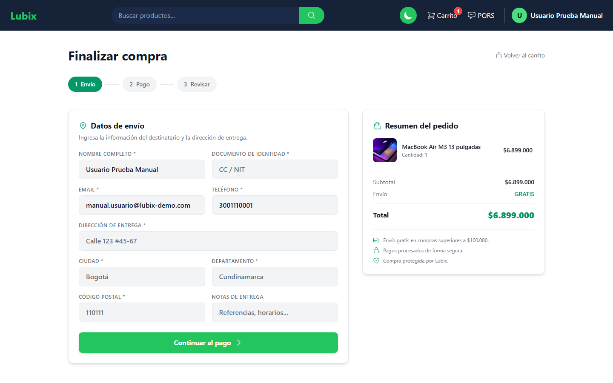

### Método de pago

* **Propósito:** Seleccionar y diligenciar el medio de pago de la compra.
* **Pasos:**
  1. Seleccionar **Tarjeta** o **PSE**.
  2. Tarjeta: ingresar **Número de tarjeta**, **Nombre del titular**, **Expiración** (MM/AA) y **CVV**; el sistema identifica Visa, Mastercard, Amex o Diners.
  3. PSE: seleccionar la entidad en **Selecciona tu banco**.
  4. Pulsar **Revisar compra** para pasar al paso **Revisar**.
* **Figura 1.1.7-9.** Método de pago con la selección Tarjeta o PSE.

  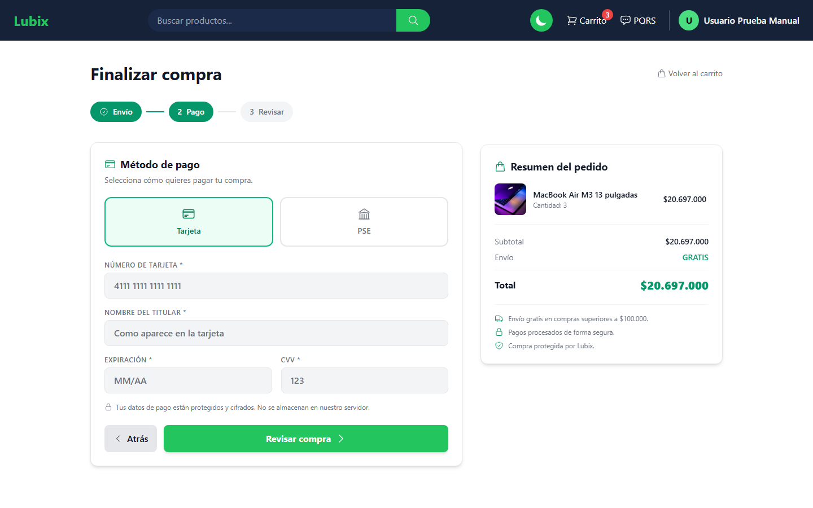

### Confirmación del pedido

* **Propósito:** Registrar el pago y emitir el acuse con el número de pedido.
* **Pasos:**
  1. En el paso **Revisar**, validar Destinatario, Método de pago, Productos y Total.
  2. Pulsar **Confirmar y pagar $[total]**.
  3. Esperar la pantalla **Procesando tu pago** sin cerrar la ventana.
  4. Verificar **¡Pago exitoso!** con **Número de pedido**, **Método de pago** y **Total pagado**; continuar con **Volver al inicio** o **Ver mis pedidos**.
* **Captura:** `[IMG: Checkout_confirmacion - Recuadro en Número de pedido y flecha a Ver mis pedidos]`

### Crear solicitud PQRS

* **Propósito:** Radicar una petición, queja, reclamo o sugerencia ante la mesa de ayuda.
* **Pasos:**
  1. Abrir **PQRS** en la barra superior (`/pqrs`).
  2. Pulsar **Nueva solicitud**.
  3. Seleccionar **Tipo de solicitud**: Petición, Queja, Reclamo o Sugerencia.
  4. Diligenciar **Asunto** y **Descripción detallada**.
  5. Pulsar **Enviar solicitud** y verificar el mensaje de éxito.
* **Figura 1.1.7-10.** Formulario Nueva solicitud PQRS con el selector de tipo.

  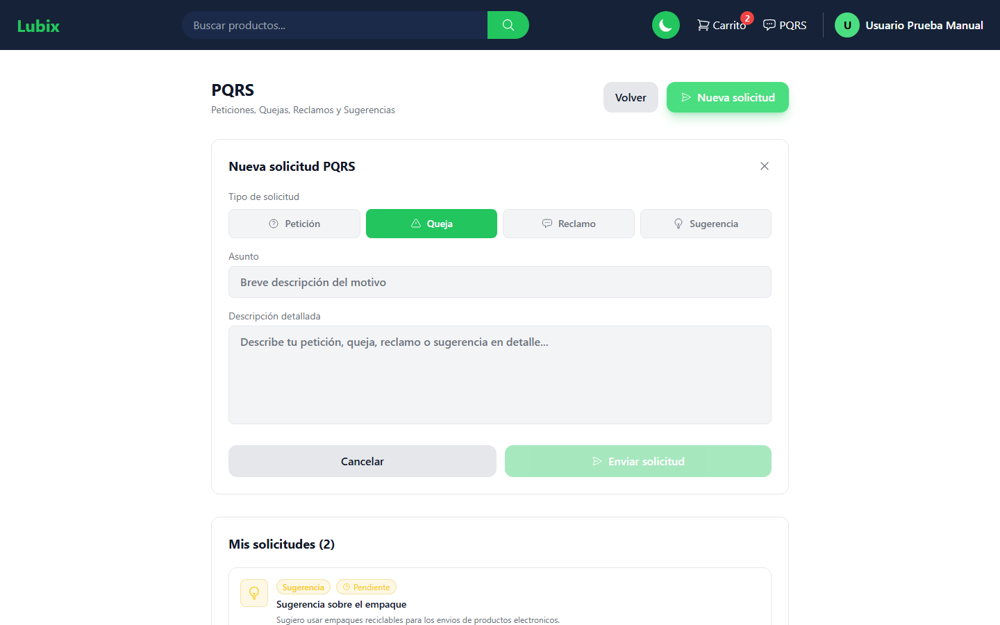

### Consultar solicitudes PQRS

* **Propósito:** Hacer seguimiento al estado de las solicitudes radicadas por el usuario.
* **Pasos:**
  1. Abrir **PQRS** y ubicar el listado **Mis solicitudes (N)**.
  2. Identificar tipo, asunto, descripción y fecha de cada registro.
  3. Verificar el estado: **Pendiente** o **Resuelta**.
  4. Usar **Volver** para regresar a la pantalla anterior.
* **Figura 1.1.7-11.** Listado Mis solicitudes con el contador y las etiquetas de estado.

  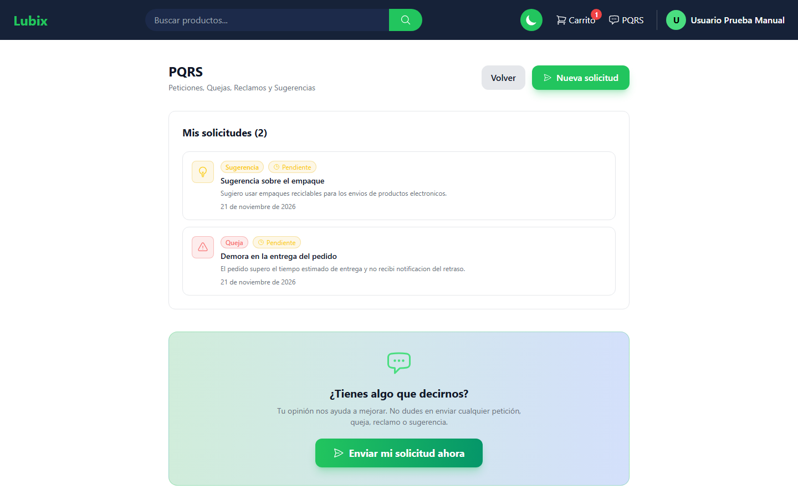

### Mis pedidos

* **Propósito:** Consultar el historial, el estado y el detalle de las compras realizadas.
* **Pasos:**
  1. Abrir el menú del usuario y elegir **Ver Perfil** (`/dashboard-usuario`).
  2. Revisar en **Resumen** los indicadores Pedidos, Total gastado, Guardados y Direcciones.
  3. En **Mis Pedidos**, ubicar el pedido por número, estado, fecha y total.
  4. Desplegar el pedido para ver productos, resumen de valores y estado del envío (Confirmado, Enviado, Entregado).
  5. Usar **Producto Entregado** o **Eliminar Producto** para gestionar los artículos recibidos.
* **Figura 1.1.7-12.** Pestaña Mis Pedidos con el pedido y su estado.

  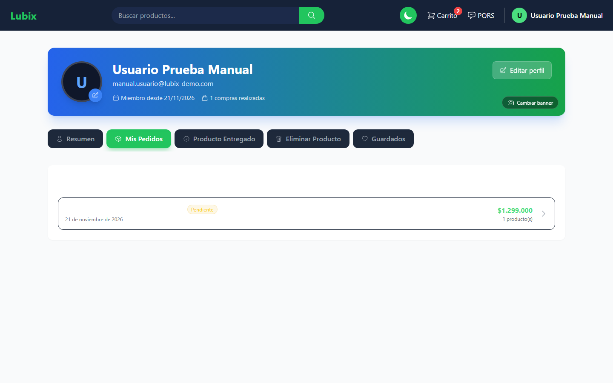

### Productos guardados

* **Propósito:** Administrar la lista de favoritos del usuario.
* **Pasos:**
  1. Abrir la pestaña **Guardados** en el perfil.
  2. Revisar nombre y precio de cada producto.
  3. Retirar el producto con el corazón de la tarjeta.
* **Captura:** `[IMG: Perfil_guardados - Recuadro en el listado y flecha al ícono de corazón]`

### Seguridad de la cuenta

* **Propósito:** Cambiar la contraseña de acceso del usuario autenticado.
* **Pasos:**
  1. Abrir **Mi perfil** (ícono de lápiz) desde el panel del usuario.
  2. En **Seguridad**, ingresar **Contraseña actual** y **Nueva contraseña**.
  3. Pulsar **Cambiar contraseña** y verificar el mensaje de confirmación.
* **Captura:** `[IMG: Perfil_seguridad - Recuadro en la sección Seguridad y flecha al botón Cambiar contraseña]`

### Direcciones

* **Propósito:** Registrar, identificar y eliminar las direcciones de envío del usuario.
* **Pasos:**
  1. En **Mi perfil → Direcciones**, diligenciar **Etiqueta**, **Código postal**, **Dirección**, **Ciudad** y **Departamento**.
  2. Marcar **Usar como dirección principal** cuando corresponda.
  3. Pulsar **Agregar dirección**.
  4. Eliminar una dirección con **Eliminar**; la principal se identifica con **(principal)**.
* **Captura:** `[IMG: Perfil_direcciones - Recuadro en el formulario y flecha al botón Agregar dirección]`

### Mis datos

* **Propósito:** Descargar la información personal del usuario y solicitar la inhabilitación de la cuenta.
* **Pasos:**
  1. En **Mi perfil → Mis datos**, pulsar **Descargar mis datos** para generar el documento con datos personales, direcciones, pedidos y favoritos.
  2. Pulsar **Solicitar inhabilitación de cuenta**.
  3. Confirmar la acción y escribir **INHABILITAR** en el control de seguridad.
  4. Verificar el mensaje de envío; la solicitud queda registrada en PQRS para revisión del administrador.
* **Captura:** `[IMG: Perfil_mis_datos - Recuadro en Descargar mis datos y flecha a Solicitar inhabilitación de cuenta]`

## Empresa

### Mis productos

* **Propósito:** Consultar y administrar el catálogo publicado por la empresa.
* **Pasos:**
  1. Ingresar con la pestaña **Empresa** y acceder al panel `/dashboard-empresa`.
  2. Abrir la pestaña **Mis Productos** y ubicar el contador **Mis Productos (N)**.
  3. Revisar en cada tarjeta el estado **Activo/Inactivo**, **Stock**, precio, **vendidos** y calificación.
  4. Pulsar **Agregar producto** o las acciones **Desactivar/Activar**, editar (lápiz) y eliminar (papelera).
* **Figura 1.1.7-13.** Pestaña Mis Productos del panel de Empresa.

  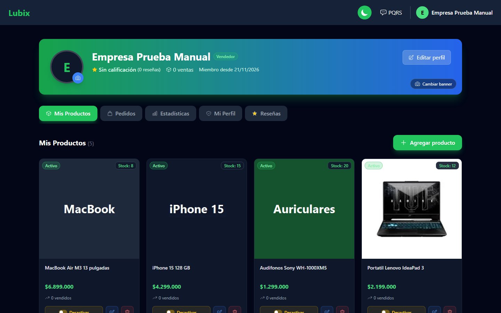

### Crear producto

* **Propósito:** Publicar un producto nuevo en el catálogo de la tienda.
* **Pasos:**
  1. Pulsar **Agregar producto** para abrir el formulario **Agregar nuevo producto**.
  2. Cargar hasta cinco imágenes (**Agregar foto** o URL); la primera será la principal.
  3. Completar los campos obligatorios: **Nombre del producto**, **Precio (COP)**, **Stock disponible**, **Categoría** y **Descripción**.
  4. Añadir opcionalmente **Descuento (%)**, **Marca**, **Modelo**, **Garantía**, **Peso** y **Dimensiones**.
  5. Pulsar **Publicar producto** y verificar el mensaje de confirmación.
* **Figura 1.1.7-14.** Modal Agregar nuevo producto con los campos obligatorios.

  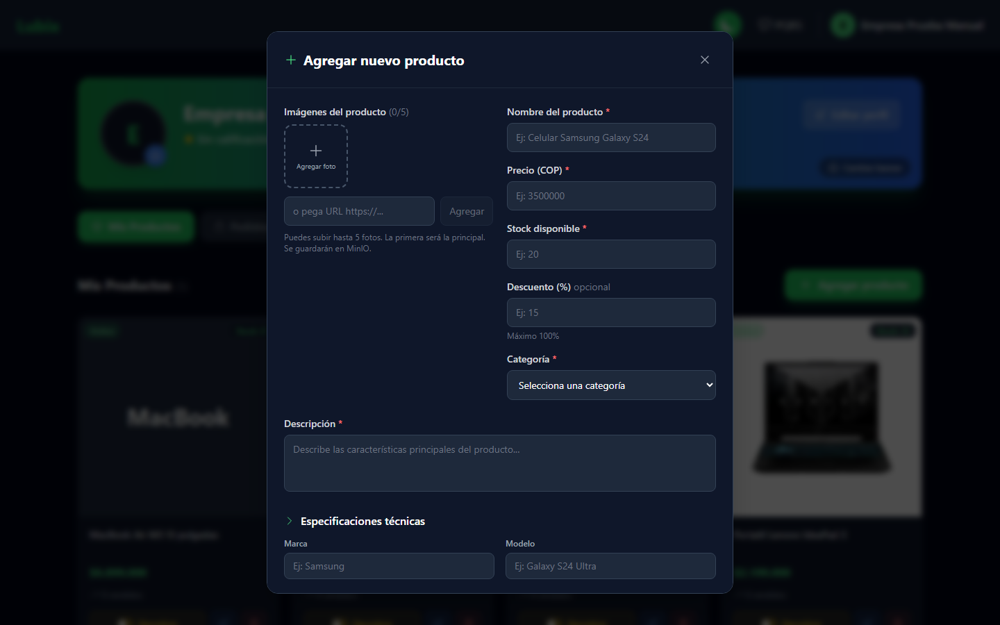

### Editar o eliminar producto

* **Propósito:** Actualizar los datos de un producto o retirarlo permanentemente del catálogo.
* **Pasos:**
  1. En **Mis Productos**, pulsar el ícono de lápiz (**Editar producto**).
  2. Modificar campos o imágenes y pulsar **Guardar cambios**.
  3. Para retirar un producto, pulsar el ícono de papelera y confirmar en **¿Eliminar producto?** con **Eliminar**.
  4. Para ocultarlo sin borrarlo, pulsar **Desactivar**; el estado cambia a **Inactivo**.
* **Figura 1.1.7-15.** Modal Editar producto con los datos precargados.

  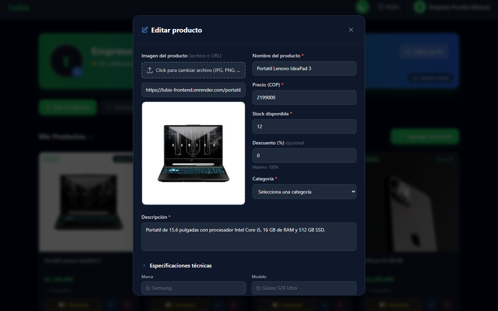

### Pedidos recibidos

* **Propósito:** Consultar los pedidos generados por los clientes sobre los productos de la tienda.
* **Pasos:**
  1. Abrir la pestaña **Pedidos** y ubicar el contador **Pedidos recibidos (N)**.
  2. Identificar número, estado, comprador, fecha, total y cantidad de productos.
  3. Desplegar el pedido para revisar **Productos**, **Resumen** y **Envío y pago**.
  4. Verificar la dirección de entrega y el método de pago registrados.
* **Figura 1.1.7-16.** Pestaña Pedidos con el pedido recibido.

  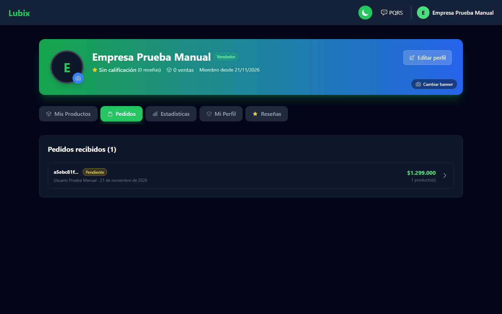

### Gestionar estado del pedido

* **Propósito:** Actualizar el ciclo de vida del pedido y notificar al cliente su avance.
* **Pasos:**
  1. En **Pedidos**, desplegar un pedido en estado **Pendiente**.
  2. Pulsar **Confirmar pedido** para pasarlo a **Confirmado** o **Rechazar** para **Cancelado**.
  3. En estado **Confirmado**, pulsar **Marcar como enviado**.
  4. En estado **Enviado**, pulsar **Marcar como entregado**; el pedido queda en **Entregado** y sin acciones disponibles.
* **Figura 1.1.7-17.** Detalle del pedido con los botones de cambio de estado.

  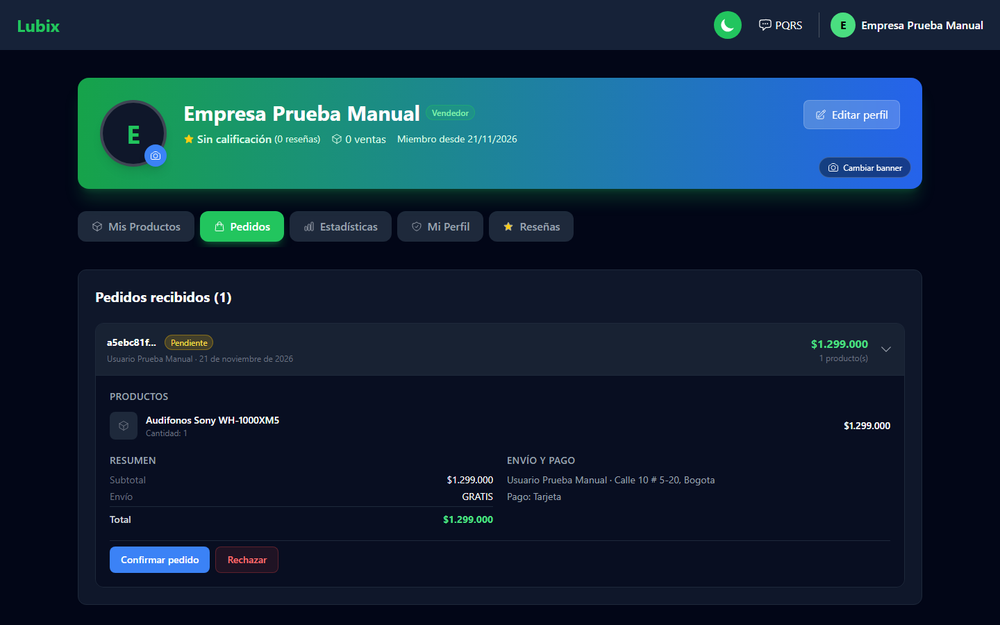

### Estadísticas

* **Propósito:** Evaluar el desempeño comercial de la tienda y de cada producto.
* **Pasos:**
  1. Abrir la pestaña **Estadísticas**.
  2. Revisar los indicadores **Productos activos**, **Ventas totales**, **Ingresos totales** y **Calificación**.
  3. Consultar **Rendimiento por producto** con el volumen de **vendidos** por artículo.
  4. Contrastar las cifras con **Reputación y métricas** en la pestaña **Mi Perfil**.
* **Figura 1.1.7-18.** Pestaña Estadísticas con los indicadores y el rendimiento por producto.

  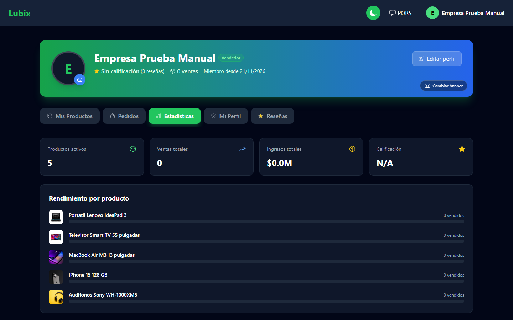

### Mi perfil

* **Propósito:** Actualizar la identidad visual y los datos de contacto del vendedor.
* **Pasos:**
  1. Abrir la pestaña **Mi Perfil**.
  2. Revisar **Información del vendedor**: **Nombre de tienda**, **Correo electrónico**, **Teléfono** y **Miembro desde**.
  3. Pulsar **Editar Información** o **Editar perfil** para abrir el panel lateral.
  4. En el panel, cambiar **Logo de la tienda**, **Banner de la tienda** y los datos de contacto.
  5. Pulsar **Guardar cambios** y verificar el mensaje de actualización.
* **Figura 1.1.7-19.** Pestaña Mi Perfil con la información del vendedor.

  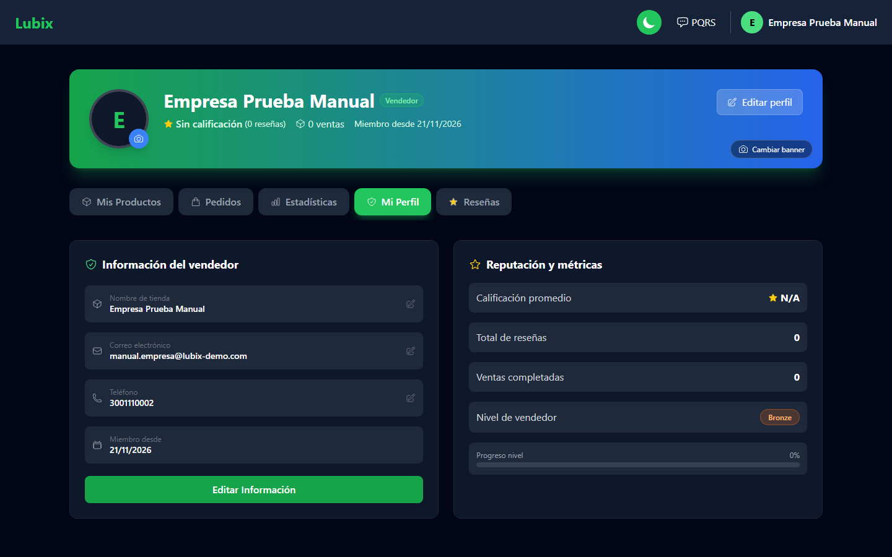

### Consultar reseñas

* **Propósito:** Revisar las calificaciones y comentarios que los clientes publican sobre los productos.
* **Pasos:**
  1. Abrir la pestaña **Reseñas**.
  2. Ubicar cada registro con **usuario**, comentario, calificación en estrellas y fecha.
  3. Verificar la escala **x/5** de cada reseña.
  4. Contrastar el total con **Calificación promedio** y **Total de reseñas** en **Mi Perfil**.
* **Captura:** `[IMG: Empresa_resenas - Recuadro en la calificación x/5 y flecha a la fecha de la reseña]`

### Crear solicitud PQRS

* **Propósito:** Radicar una petición, queja, reclamo o sugerencia ante la mesa de ayuda.
* **Pasos:**
  1. Abrir **PQRS** en la barra superior (`/pqrs`).
  2. Pulsar **Nueva solicitud**.
  3. Seleccionar **Tipo de solicitud**: Petición, Queja, Reclamo o Sugerencia.
  4. Diligenciar **Asunto** y **Descripción detallada**.
  5. Pulsar **Enviar solicitud** y verificar el mensaje de éxito.
* **Captura:** `[IMG: Empresa_pqrs_nueva - Recuadro en el selector de tipo y flecha al botón Enviar solicitud]`

### Consultar solicitudes PQRS

* **Propósito:** Hacer seguimiento al estado de las solicitudes radicadas por la empresa.
* **Pasos:**
  1. Abrir **PQRS** y ubicar el listado **Mis solicitudes (N)**.
  2. Identificar tipo, asunto, descripción y fecha de cada registro.
  3. Verificar el estado: **Pendiente** o **Resuelta**.
  4. Usar **Volver** para regresar a la pantalla anterior.
* **Captura:** `[IMG: Empresa_pqrs_listado - Recuadro en el contador Mis solicitudes y flecha a la etiqueta de estado]`

## Administrador

### Resumen general

* **Propósito:** Supervisar el estado global de usuarios, empresas y solicitudes de la plataforma.
* **Pasos:**
  1. Iniciar sesión con la pestaña **Usuario** y credenciales administrativas; el sistema redirige a `/dashboard-admin`.
  2. Revisar los indicadores **Usuarios registrados**, **Empresas registradas**, **Empresas por validar** y **Cuentas activas**.
  3. Consultar el bloque **Empresas por validar (N)** y usar **Ver todas** para abrir la pestaña **Empresas**.
  4. Navegar entre las pestañas **Resumen**, **Empresas (N)**, **Usuarios (N)** y **PQRS (N)**.
* **Figura 1.1.7-20.** Pestaña Resumen del panel de Administración.

  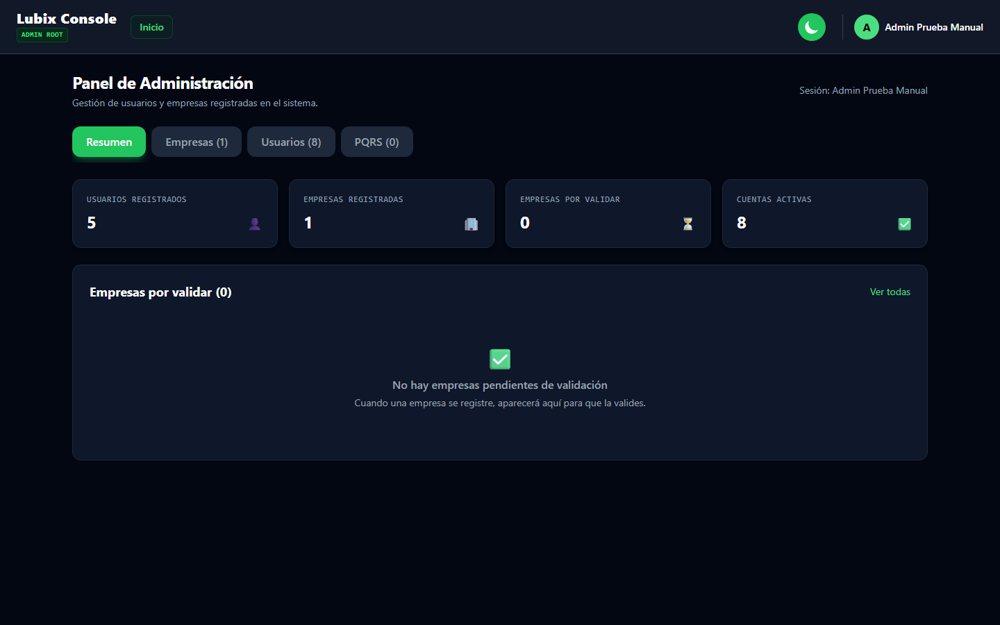

### Validar empresa

* **Propósito:** Aprobar el registro de una empresa para habilitar su acceso y operación en la plataforma.
* **Pasos:**
  1. Abrir la pestaña **Empresas** o el bloque **Empresas por validar**.
  2. Verificar **Empresa**, **NIT**, **Contacto** (correo, propietario y teléfono), **Registro** y estado **Pendiente**.
  3. Pulsar **Validar empresa** en el registro correspondiente.
  4. Confirmar el cambio de estado a **Validada** y la actualización del indicador **Empresas por validar**.
* **Figura 1.1.7-21.** Pestaña Empresas del panel de Administración.

  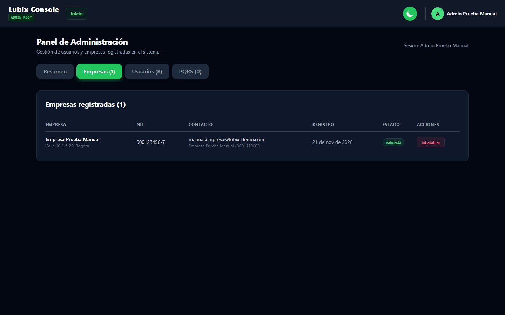

### Habilitar o inhabilitar empresa

* **Propósito:** Suspender o restablecer el acceso de una empresa registrada.
* **Pasos:**
  1. Abrir **Empresas (N)** y ubicar la empresa en la tabla **Empresas registradas (N)**.
  2. Verificar el estado **Validada/Pendiente** y la columna **Acciones**.
  3. Pulsar **Inhabilitar** o **Habilitar** según corresponda.
  4. Confirmar la acción en el diálogo del navegador y verificar el nuevo estado.
* **Figura 1.1.7-22.** Columna Acciones de la gestión de empresas.

  

### Gestionar usuarios

* **Propósito:** Consultar las cuentas registradas y controlar su acceso a la plataforma.
* **Pasos:**
  1. Abrir la pestaña **Usuarios** y ubicar el contador **Usuarios registrados (N)**.
  2. Revisar **Usuario**, **Email**, **Teléfono**, **Rol**, **Registro** y **Estado**.
  3. Pulsar **Inhabilitar** o **Habilitar** en la fila del usuario.
  4. Confirmar la acción en el diálogo; las cuentas con rol **Admin** no permiten el cambio.
* **Figura 1.1.7-23.** Gestión de usuarios con el estado Activo/Inactivo; los datos personales están difuminados.

  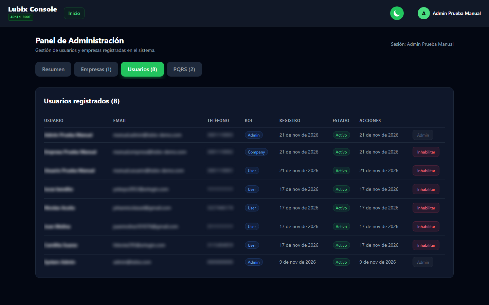

### Resolver PQRS

* **Propósito:** Atender y cerrar las peticiones, quejas, reclamos, sugerencias y solicitudes de eliminación recibidas.
* **Pasos:**
  1. Abrir la pestaña **PQRS** y ubicar el contador **PQRS recibidas (N)**.
  2. Identificar tipo, estado, rol del remitente (**Empresa/Usuario**), asunto, descripción, remitente y fecha.
  3. Pulsar **Marcar resuelta** en una solicitud con estado **Pendiente**.
  4. Verificar el cambio de estado a **Resuelta** y el resaltado en verde del registro.
* **Figura 1.1.7-24.** PQRS recibidas con la opción Marcar resuelta.

  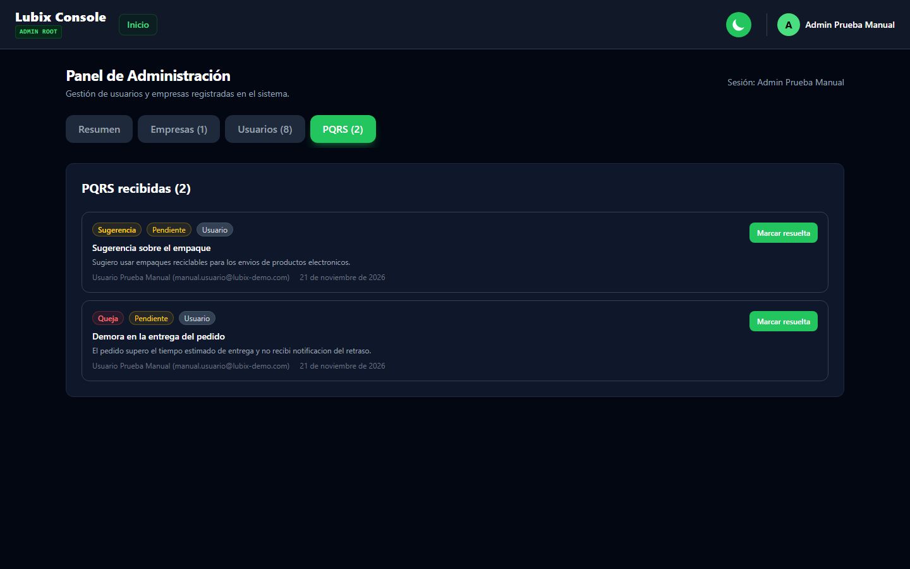

---

## Estado de capturas

Capturas reales incorporadas en esta versión: 24. Permanecen pendientes las correspondientes a publicación de reseña, confirmación del pedido, productos guardados, seguridad de la cuenta, direcciones, mis datos, reseñas de la empresa y las dos de PQRS de la empresa.
