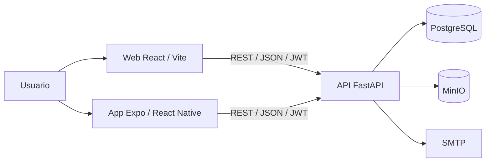
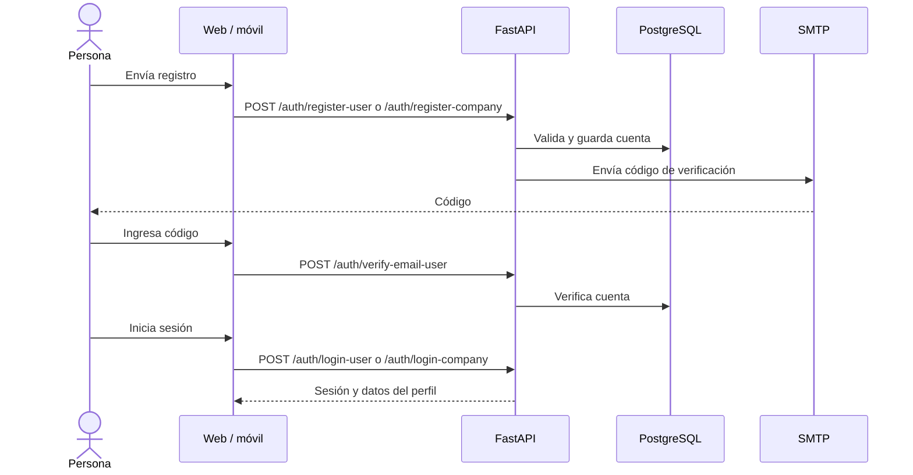
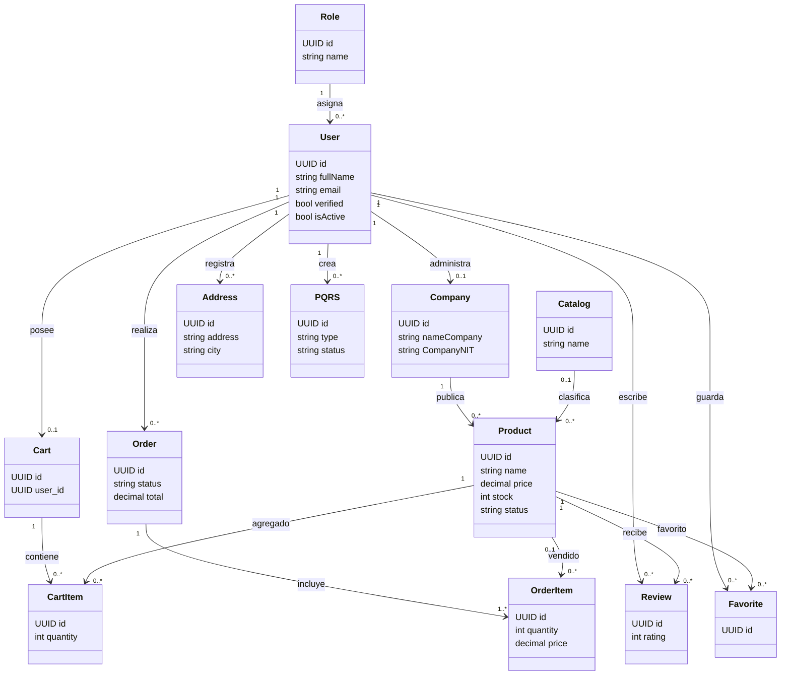
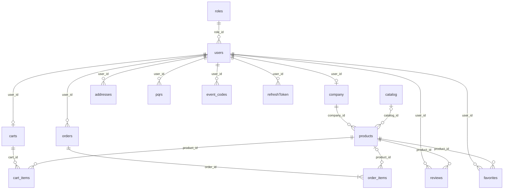

# Guía resuelta: manual de usuario y manual técnico de LUBIX

**Proyecto:** LUBIX — Plataforma de Gestión Empresarial
**Fecha:** 30 de octubre de 2026
**Estado:** Borrador elaborado a partir del código y la documentación disponibles en el repositorio
**Público:** usuarios, empresas, administradores y personal técnico

> Este documento desarrolla los ejercicios de creación del manual de usuario y del manual
> técnico propuestos en `Manual tecnico y de usuario.pdf`. Sustituye el ejemplo ficticio
> odontológico por las funciones y componentes comprobables de LUBIX. Los requisitos que
> están definidos en documentos pero no verificados en producción se identifican como metas,
> no como garantías.

## 1. Manual de usuario

### 1.1 Alcance

LUBIX es un marketplace web y móvil que conecta compradores con empresas que publican
productos. Permite consultar el catálogo, buscar productos, gestionar favoritos y carrito,
realizar pedidos y consultar la cuenta. Las empresas administran su perfil, publicaciones
y pedidos recibidos. Los administradores gestionan usuarios, empresas y solicitudes PQRS.

Las opciones disponibles dependen del tipo de cuenta y de los permisos asignados. La
dirección pública de producción debe ser suministrada por el responsable de la instalación;
para desarrollo local, el sitio web se sirve en `http://localhost:5173`.

### 1.2 Perfiles y permisos

| Perfil | Funciones principales |
|---|---|
| Visitante | Consultar el inicio, buscar productos y ver fichas públicas de productos y empresas. |
| Usuario comprador | Gestionar perfil y direcciones, favoritos, carrito, pedidos, reseñas y PQRS; completar el flujo de compra. |
| Empresa | Administrar el perfil comercial, productos e imágenes, y consultar y actualizar sus pedidos. |
| Administrador | Consultar usuarios y empresas, cambiar su estado, validar empresas y gestionar PQRS. |

Las opciones administrativas y comerciales requieren iniciar sesión con la cuenta del rol
correspondiente. No se deben compartir cuentas ni intentar acceder a funciones de otro perfil.

### 1.3 Requisitos para utilizar el sistema

**Conocimientos previos:** navegación básica por Internet, uso de formularios y correo
electrónico. Para operar el panel de empresa o administración se requiere autorización
para ese perfil.

**Equipo cliente:** computador o teléfono con conexión a Internet. La ficha técnica del
proyecto toma como referencia un computador de 2 núcleos y 2 GB de RAM para navegación.

**Software:** navegador web actualizado (por ejemplo, Chrome, Edge o Firefox). La aplicación
móvil requiere una instalación compatible con Expo/React Native y una URL de API accesible
desde el dispositivo. Para teléfonos físicos, el servidor debe ser accesible desde la red
local o desde la URL de producción.

### 1.4 Seguridad básica de la cuenta

1. Utilice una contraseña propia, difícil de adivinar y distinta de la que usa en otros
   servicios. No la comparta ni la incluya en solicitudes de soporte.
2. Verifique la dirección de correo cuando el registro lo solicite. Los códigos de
   verificación y recuperación son personales y tienen vencimiento.
3. Use **Cerrar sesión** al terminar, en especial en equipos compartidos.
4. Acceda únicamente por la URL oficial comunicada por el administrador. En producción,
   la instalación debe publicar el servicio mediante HTTPS.
5. Si sospecha que otra persona usó su cuenta, cambie la contraseña y reporte el incidente
   mediante PQRS o al administrador del sistema.

### 1.5 Registro e ingreso

#### Crear una cuenta de usuario

1. Abra la aplicación y seleccione la opción para registrarse como usuario.
2. Complete los datos solicitados, entre ellos nombre, correo, teléfono y contraseña.
3. Envíe el formulario y revise el correo para obtener el código de verificación.
4. Ingrese el código en la pantalla de verificación. Si no llega, revise correo no deseado
   y use la opción para reenviar el código.
5. Cuando la cuenta esté verificada, vuelva al ingreso e inicie sesión con correo y
   contraseña.

#### Registrar una empresa

1. Seleccione el registro de empresa y complete los datos del responsable y de la empresa,
   incluidos NIT, dígito de verificación y dirección.
2. Adjunte el certificado solicitado por el formulario y envíe la solicitud.
3. Complete la verificación de correo si se solicita. La habilitación comercial puede
   requerir validación administrativa; el repositorio no establece un plazo de aprobación.
4. Inicie sesión desde la opción de empresa con el NIT y la contraseña registrados.

#### Recuperar acceso

Desde la pantalla de ingreso, abra la opción de recuperación de contraseña, solicite el
código para el correo de la cuenta y siga las instrucciones para establecer una contraseña
nueva. Si el código expiró, solicite otro. No envíe el código al personal de soporte.

### 1.6 Navegación general

La navegación cambia según el estado de sesión y el rol:

```text
Inicio / catálogo
├── Buscar productos ──> Detalle del producto ──> Empresa
├── Registro / ingreso
│   ├── Comprador ──> Inicio del usuario ──> Perfil / pedidos / favoritos
│   │                                  └──> Carrito ──> Pago / confirmación
│   ├── Empresa ──> Panel de empresa ──> Perfil / productos / pedidos
│   └── Administrador ──> Panel de administración ──> Usuarios / empresas / PQRS
└── PQRS
```

En web, las rutas de referencia del proyecto incluyen `/`, `/buscar`, `/producto/:id`,
`/empresa/:id`, `/home-usuario`, `/dashboard-usuario`, `/dashboard-empresa`,
`/dashboard-admin`, `/carrito`, `/pago` y `/pqrs`. La navegación visible puede variar
según la versión desplegada.

### 1.7 Funciones principales

| Función | Cómo utilizarla |
|---|---|
| Buscar productos | Abra **Buscar**, escriba un término y aplique los filtros disponibles. Abra un resultado para revisar precio, imágenes, descripción, disponibilidad y datos asociados. |
| Favoritos | Inicie sesión como comprador y use la acción de favoritos en la ficha del producto. Consulte la lista desde su perfil o panel de usuario. |
| Carrito | Desde un producto disponible, agréguelo al carrito. Revise cantidades y disponibilidad; puede actualizar la cantidad, retirar un producto o vaciar el carrito. |
| Realizar un pedido | Inicie sesión como comprador, revise el carrito, indique o seleccione una dirección de entrega y complete los pasos que presenta el checkout. Confirme el pedido y conserve la información que muestra el sistema. La integración con una pasarela de pago no se considera confirmada por el código revisado. |
| Consultar pedidos | Abra el perfil o panel del comprador y consulte el historial y detalle de los pedidos. Las acciones de cancelación o consulta dependen del estado del pedido y de las opciones habilitadas. |
| Administrar perfil y direcciones | Desde el perfil, actualice los datos editables y agregue, modifique o elimine direcciones de entrega. Puede marcar una dirección como predeterminada. |
| Reseñar un producto | En la ficha del producto, use el formulario de reseña si está disponible para su cuenta y para ese producto. |
| Administrar catálogo de empresa | En el panel de empresa, consulte sus productos; cree, edite, active/desactive o elimine publicaciones y gestione sus imágenes. |
| Atender pedidos de empresa | En el panel de empresa, consulte los pedidos asociados a sus productos y actualice su estado usando las opciones disponibles. |
| Administración | El administrador puede revisar usuarios, empresas y PQRS; validar empresas y cambiar estados desde el panel de administración. |

**Flujo recomendado de compra**

1. Busque el producto y revise su descripción y stock.
2. Agréguelo al carrito e inicie sesión si la aplicación lo solicita.
3. Revise el contenido y las cantidades del carrito.
4. En el checkout, complete los datos de entrega y seleccione las opciones presentadas.
5. Confirme el pedido y consulte su resultado en el historial.

### 1.8 Mensajes y solución de problemas

| Situación o mensaje | Qué hacer |
|---|---|
| Correo o contraseña no válidos | Verifique el correo, el tipo de ingreso (usuario o empresa) y la contraseña. Si persiste, use recuperación de contraseña. |
| Cuenta pendiente de verificación | Revise el correo registrado y complete la verificación; solicite un nuevo código si expiró. |
| Empresa sin acceso al panel | Compruebe que ingresó como empresa. Si la cuenta aún requiere validación, contacte al administrador. |
| Producto no disponible o stock insuficiente | Actualice la ficha y reduzca la cantidad solicitada. El stock puede cambiar mientras el producto permanece en el carrito. |
| Sesión expirada o acceso denegado | Inicie sesión nuevamente con la cuenta correcta. No comparta ni copie tokens de sesión. |
| No se puede conectar con el servicio | Compruebe la conexión a Internet y vuelva a cargar la aplicación. Si continúa, reporte la hora, la pantalla y los pasos realizados, sin incluir contraseñas ni códigos. |
| Error al guardar perfil, dirección o pedido | Revise los campos obligatorios y vuelva a intentar una sola vez. Si el problema continúa, informe el mensaje exacto al administrador. |

Los textos concretos pueden variar entre versiones. No reintente repetidamente una compra
si no sabe si el pedido se registró; revise primero el historial o consulte al administrador.

### 1.9 Mesa de ayuda y PQRS

La aplicación cuenta con un flujo de PQRS para registrar peticiones, quejas, reclamos o
sugerencias; el administrador puede revisar y actualizar su estado. Para reportar un
problema, indique el tipo de solicitud, asunto, descripción, fecha y pasos para reproducirlo.

El repositorio no define un correo, teléfono, horario ni compromiso de respuesta de soporte.
Para asuntos operativos, solicite esos datos al responsable de la instalación. Nunca adjunte
contraseñas, códigos de verificación, tokens o datos de pago sensibles.

## 2. Manual técnico

### 2.1 Alcance técnico

LUBIX está organizado como una solución cliente-servidor: aplicación web y aplicación móvil
consumen una API REST común; la API implementa autenticación, permisos y reglas de negocio,
y utiliza PostgreSQL y MinIO. El correo transaccional se configura mediante SMTP.

Este manual describe el código presente en el repositorio. La disponibilidad, el rendimiento,
la pasarela de pago, el cumplimiento de niveles de servicio y la operación productiva deben
validarse en el entorno de despliegue; no se infieren como capacidades garantizadas.

### 2.2 Componentes y tecnologías

| Capa | Componente | Tecnología / función |
|---|---|---|
| Presentación web | `frontend/` | React 19, TypeScript, Vite, React Router y Tailwind CSS. |
| Presentación móvil | `mobile/` | Expo SDK 54, React Native 0.81 y React Navigation. |
| API | `backend/` | Python 3.13+, FastAPI, Pydantic y SQLAlchemy. |
| Persistencia | PostgreSQL | Base de datos relacional; cambios de esquema con Alembic. |
| Archivos | MinIO | Almacenamiento de imágenes y documentos compatible con objetos S3. |
| Autenticación | Backend | JWT de acceso/renovación; contraseñas almacenadas mediante hash. |
| Correo | SMTP | Verificación de cuentas y recuperación de contraseña. |
| Despliegue de desarrollo | Docker Compose | Orquesta PostgreSQL, MinIO, backend, web y móvil. |

Las versiones exactas se consultan en `backend/pyproject.toml`, `frontend/package.json` y
`mobile/package.json`; el backend requiere Python `>=3.13`, la web declara React 19 y móvil
usa Expo 54 / React Native 0.81. Las versiones de servicios `latest` pueden cambiar y deben
fijarse para una instalación productiva reproducible.

### 2.3 Arquitectura y despliegue local



Puertos publicados por el `docker-compose.yml` actual:

| Servicio | Puerto del equipo | Puerto del contenedor | Uso |
|---|---:|---:|---|
| Web | 5173 | 5173 | Interfaz de desarrollo. |
| Backend | 8002 | 8000 | API; Swagger en `http://localhost:8002/docs`. |
| PostgreSQL | 5435 | 5432 | Conexión local de desarrollo; entre contenedores, host `postgres:5432`. |
| MinIO API | 9100 | 9000 | API de objetos. |
| MinIO consola | 9101 | 9001 | Consola administrativa de desarrollo. |
| Expo / Metro | 8081 | 8081 | Servidor de desarrollo móvil. |

Procedimiento base de desarrollo:

1. Copiar `.env.example` a `.env` y configurar credenciales propias para PostgreSQL,
   JWT, MinIO y correo. No publicar el archivo `.env`.
2. Construir y arrancar: `docker compose up --build -d`.
3. Revisar el estado con `docker compose ps` y los registros con
   `docker compose logs -f backend`.
4. Confirmar la API en `/docs` y verificar `/health/database` y `/health/internet`.
5. Configurar `EXPO_PUBLIC_API_URL` para que el móvil alcance el backend desde su emulador
   o dispositivo físico.

**Diferencia entre documentación y configuración:** algunos README y documentos existentes
todavía indican el puerto `8001`, mientras que el `docker-compose.yml` actual publica el
backend en `8002`. Para el Compose incluido en este repositorio, use `8002` y alinee las
variables de los clientes antes de ejecutar pruebas. En producción se debe configurar una
URL HTTPS accesible desde cada cliente, no `localhost`.

### 2.4 Procesos principales

#### Registro e inicio de sesión



#### Compra

1. La persona consulta `/products`, busca o abre un producto.
2. El cliente agrega o actualiza productos en `/cart`; el backend valida existencia,
   estado y disponibilidad.
3. El comprador envía los datos de pedido a `/user/orders`.
4. El backend guarda `orders` y `order_items`, actualiza inventario y permite consultar,
   cancelar o solicitar la información de factura según las rutas disponibles.

#### Administración comercial

La empresa utiliza `/company` para editar su perfil, administrar publicaciones e imágenes,
consultar pedidos y actualizar estados. El administrador utiliza `/admin` para gestionar
usuarios, empresas, validación comercial y PQRS.

### 2.5 Diagrama UML de clases del dominio



### 2.6 Modelo relacional de datos

El esquema se define mediante modelos SQLAlchemy en `backend/app/models/` y se administra
con Alembic. Las relaciones principales son:



| Tabla | Propósito |
|---|---|
| `roles`, `users`, `company` | Roles, cuentas y perfil asociado de empresa. |
| `catalog`, `products` | Catálogos y publicaciones con precio, stock, estado e imágenes. |
| `carts`, `cart_items` | Carrito por comprador y sus productos/cantidades. |
| `orders`, `order_items` | Pedidos, totales y detalle de productos comprados. |
| `addresses` | Direcciones de entrega del comprador. |
| `reviews`, `favorites` | Reseñas y productos guardados por usuario. |
| `pqrs` | Solicitudes de soporte y su estado. |
| `event_codes`, `refreshToken` | Códigos de verificación/recuperación y sesiones renovables. |

Los identificadores principales son UUID y las relaciones se implementan con llaves
foráneas. Algunos vínculos de carrito y favoritos aplican restricciones de unicidad para
evitar repetir el mismo producto en la colección correspondiente.

### 2.7 Documentación del código fuente y API

| Ruta | Responsabilidad |
|---|---|
| `backend/app/main.py` | Crea FastAPI, conecta routers, middleware y carga inicial opcional. |
| `backend/app/routers/` | Endpoints de autenticación, usuarios, empresas, catálogo, carrito, administración, archivos y salud. |
| `backend/app/services/` | Lógica de autenticación, correo, almacenamiento y paneles comerciales. |
| `backend/app/models/` | Entidades y relaciones SQLAlchemy. |
| `backend/app/schemas/` | Validación de solicitudes y respuestas con Pydantic. |
| `backend/app/database/Connection.py` | Motor PostgreSQL y ciclo de vida de sesiones. |
| `backend/alembic/` | Migraciones del esquema. |
| `frontend/src/pages/`, `components/`, `context/`, `api/` | Pantallas, navegación, estado y llamadas REST de la web. |
| `mobile/src/screens/`, `navigation/`, `context/`, `api/` | Pantallas, navegación, estado y llamadas REST móvil. |
| `docker-compose.yml`, `.env.example` | Servicios y nombres de configuración del entorno local. |

Los grupos principales de rutas del backend son `/auth`, `/user`, `/company`, `/admin`,
`/products`, `/cart`, `/favorites`, `/pqrs`, `/files` y `/health`. La especificación
interactiva que genera FastAPI en `/docs` debe prevalecer sobre documentos de endpoints
antiguos: por ejemplo, los README existentes no siempre reflejan los nombres de las rutas
ni el puerto actuales.

### 2.8 Administración de usuarios y controles

- Los roles usados por la aplicación son `user`, `empresa` y `admin`.
- El middleware de autenticación valida la sesión para las rutas que la requieren; el
  cliente también redirige a la pantalla de ingreso cuando se intenta abrir una ruta
  protegida sin el rol esperado.
- El panel administrativo contempla consulta y cambio de estado de usuarios y empresas,
  validación de empresas y gestión de PQRS.
- La cuenta inicial, cuando se habilita el seed, se configura mediante variables de entorno.
  Cambie inmediatamente las credenciales iniciales y desactive el seed después de la carga
  inicial; no copie credenciales de ejemplo a una instalación expuesta.
- Configure secretos únicos y fuertes para `SECRET_KEY`, PostgreSQL y MinIO. No almacene
  secretos en el repositorio ni en capturas o reportes.
- Publique la aplicación de producción detrás de HTTPS y limite la exposición de PostgreSQL
  y de la consola MinIO a redes administrativas.

### 2.9 Acuerdos de nivel de servicio (ANS)

El repositorio no contiene un ANS contractual ni una política completa de atención con
responsables, canales, horarios, severidades y tiempos de respuesta. Por ello, no se debe
presentar ninguna cifra siguiente como compromiso de servicio ya cumplido.

Los RNF definen metas que deben validarse antes de adoptarse como ANS:

| Indicador documentado | Meta registrada | Estado que debe comunicarse |
|---|---:|---|
| Lectura simple de API | < 200 ms | Requisito; falta evidencia de medición de producción. |
| Operación compleja de API | < 500 ms | Requisito; validar con pruebas de carga. |
| Carga inicial web | < 3 s | Requisito; validar por entorno y dispositivo. |
| Disponibilidad mensual | >= 99.5% | Meta RNF; requiere monitoreo y cálculo mensual. |
| Recuperación ante fallos | RNF-008: < 2 min; RNF-009: < 60 s | Los documentos difieren; acordar un único objetivo y probarlo. |
| Respaldos PostgreSQL | RNF-009 propone cada 6 horas | Requiere automatización, retención y pruebas de restauración. |

El Compose actual publica `/health/database` y `/health/internet`; los RNF mencionan
`/health` y `/readiness`, rutas que no coinciden con esos endpoints. Antes de declarar
disponibilidad garantizada, alinear los criterios, implementar el monitoreo y documentar
el procedimiento de incidentes y recuperación. Los compromisos de soporte deben ser
aprobados por el responsable del servicio.

### 2.10 Referencias del proyecto

- [Ficha técnica](../Ficha_Tecnica.md): tecnologías, puertos y requisitos de equipo.
- [Guía de instalación](../Instalacion_v0.md): preparación y ejecución con Docker Compose.
- [Documento de implantación](../BC-Implantacion.md): seguridad, instalación, respaldo y mantenimiento.
- [RNF de tiempo de respuesta](../RNFs/RNF-001%20%E2%80%94%20Tiempo%20de%20respuesta.md).
- [RNF de disponibilidad](../RNFs/RNF-008%20%E2%80%94%20Disponibilidad%20del%20sistema.md).
- [RNF de recuperación](../RNFs/RNF-009%20%E2%80%94%20Recuperaci%C3%B3n%20ante%20fallos.md).

---

**Pendiente de aprobación:** confirmar URL de producción, identidad y canales de soporte,
versiones desplegadas, reglas vigentes de pago, política de aprobación de empresas y ANS
aceptados por la organización. Esta información no se inventa porque no está determinada
por el código inspeccionado.
